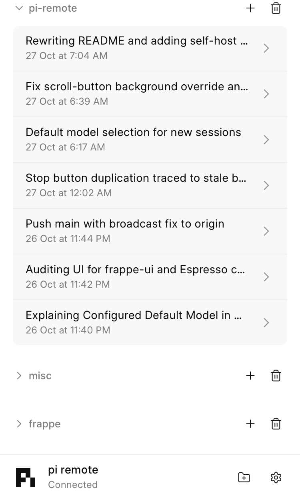
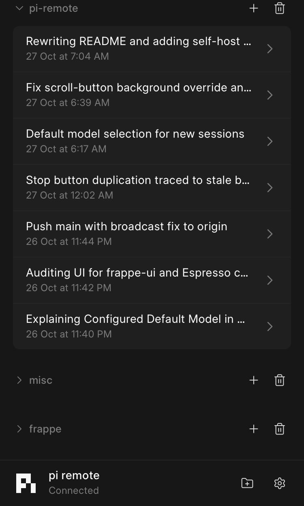

#  pi remote

A web client for the [pi coding agent](https://pi.dev). The server runs pi on one machine. You open the client in a browser on any of your devices and work with the same sessions.

<p align="center">
  
  
</p>

The stack is self-hosted. Caddy serves HTTPS on your domain. Authelia asks for a password and a second factor before a request reaches the server.

## Install your own server

One machine runs everything: the server, Caddy, Authelia, and a SearXNG web search engine. The [system requirements](docs/system-requirements.md) list what the host and the client devices need.

Before you run the installer:

1. Have a fresh Ubuntu 24.04 or Debian machine and log in as a normal user with sudo.
2. Point DNS `A` records for `pi.<domain>` and `auth.<domain>` at the public IPv4 of the machine. Both names must share the parent domain, because the login session cookie is set on it.
3. Allow ports 80 and 443 in the firewall of your cloud provider.

Then run:

```sh
git clone https://github.com/stravo1/pi-remote.git
cd pi-remote
bash deploy/easy-install.sh
```

The script asks for the domain, a login name, and an email. Set `DOMAIN`, `PI_USER`, and `PI_EMAIL` to skip the questions. It installs pinned versions of Node, Caddy, and Authelia, builds the app, writes the configuration files, asks you to choose a password for the login, and starts systemd user services for all three programs. It also installs SearXNG for web search and adds a 1 GB swap file on a machine with less than 3 GB of memory. The script is safe to run again. Each step skips what already exists.

When the script ends:

1. Wait until Caddy gets the HTTPS certificates. The DNS records must resolve to the machine first.
2. Open `https://pi.<domain>` and sign in. Authelia writes a link to the second-factor setup in `~/.local/state/authelia/notifications.txt`.
3. Open Settings in pi remote and add an AI provider.

To check the services, run `bash deploy/check-services.sh pi.<domain>`. The [deployment guide](docs/deployment.md) explains services, logs, and updates in full.

## Develop it locally

Use Node 22.19 or later. Run these commands from the repository root:

```sh
npm install
cp config.example.json config.local.json
```

Set `projectsRoot` in the configuration file to the folder that holds your projects. pi remote lists every folder below it as a project.

Add credentials for a model provider in the app: open Settings, pick a provider, and follow its sign-in. pi stores the keys and keeps them across a restart. The provider list never contains keys. The server sends a saved key to the browser only when you open its edit row in Settings.

Start the backend with automatic restart in one terminal:

```sh
npm run dev -w server -- "$PWD/config.local.json"
```

Start Vite with Vue hot reload in a second terminal:

```sh
npm run dev -w web -- "$PWD/config.local.json"
```

Open the `origin` from your configuration file. The example uses `http://127.0.0.1:8080`. Vite reads the same file and proxies `/api` and `/ws` to the backend. It adds the configured user header for local WebSocket connections. No Caddy or Authelia is needed for development. The development server listens only on loopback.

To open it from a phone on the same network, add `--lan`:

```sh
npm run dev -w web -- "$PWD/config.local.json" --lan
```

Vite prints a network URL, such as `http://192.168.1.5:8080`. With `--lan`, anyone on the network can use pi through this server without a login. Use it only on a network you trust.

Both commands take the same configuration path. Restart them after you change that file. Changes to Vue components and styles reload through Vite without a build.

Check your changes with:

```sh
npm test
npm run check
npm run build
```

Run the isolated browser checks with:

```sh
npx playwright install chromium
npm run test:browser -w web
```

The browser checks use headless Chromium with a temporary profile at 375 px and 1280 px. They cover tool diffs, the model sheet, thinking levels, follow-up, steer, and Stop. Screenshots go to `pi-remote-phase-3` inside the system temporary directory. If Chromium is already installed elsewhere, set `PLAYWRIGHT_CHROMIUM_EXECUTABLE_PATH` to that browser executable.

To test the production build locally, start the backend without watch mode:

```sh
npm start -- "$PWD/config.local.json"
```

In a second terminal, start [Caddy](https://caddyserver.com/docs/install):

```sh
caddy run --config dev/Caddyfile --adapter caddyfile
```

Open `http://127.0.0.1:8080` in your browser. The [local proxy configuration](dev/Caddyfile) replaces `Remote-User` with `me`. It listens on loopback and has no login. Use it for local development only. The server checks the WebSocket origin and user header. Direct browser connections to port 7710 fail because browsers cannot set that header.

## Documents

- [Specification](docs/spec.md): what the system does, how the parts fit, and the design decisions.
- [Roadmap](docs/roadmap.md): the build order, in phases. Each phase ends with something you can use.
- [System requirements](docs/system-requirements.md): what the host machine and the client devices need.
- [Deployment](docs/deployment.md): the host setup, login configuration, and proxy templates.
- [Phase docs](docs/phases/README.md): the plan, progress, and handoff for each phase.
- [pi events](docs/pi-events.md): findings about pi's session storage and event format.

## Layout

```
pi-remote/
  server/   Node + TypeScript. Owns the pi sessions.
  web/      Vue 3 + frappe-ui. The browser client.
  docs/
```

`server` and `web` are npm workspaces in one repository. The client follows frappe-ui's [standalone setup](https://ui.frappe.io/docs/getting-started/standalone).

## License

[MIT](LICENSE)
